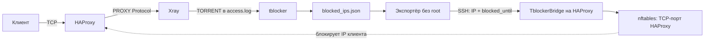

<div align="center">

# TblockerBridge

**Торрент обнаружен на выходной ноде. Блокировка действует там, где подключён клиент.**


[](https://github.com/zavul0nn/TblockerBridge/actions/workflows/tests.yml)

Синхронизация блокировок **Xray Torrent Blocker → HAProxy** через SSH и nftables.

[Установка](#установка) · [Как это работает](#как-это-работает) · [Безопасность](#безопасность) · [Управление](#управление) · [Диагностика](#диагностика)

</div>

---

## Зачем

Когда клиент подключается к Xray через HAProxy с PROXY Protocol, Xray видит его настоящий IP. Но firewall выходной ноды видит IP прокси. tblocker обнаруживает торрент и блокирует настоящий адрес — а соединение через HAProxy продолжает работать.

**TblockerBridge переносит блокировку на входной HAProxy-сервер.** Только на нужный TCP-порт, только на оставшееся время. Трафик уже установленных соединений тоже перестаёт проходить.

### Что умеет

- Передаёт полное состояние через постоянное SSH-соединение примерно раз в секунду.
- Использует штатный `blocked_ips.json`, не дублирует парсер access.log и не запускает второй tblocker.
- Отслеживает новые блокировки, изменение срока и досрочное снятие.
- Переживает перезапуск службы и восстанавливает неистёкшие сроки из кеша.
- Снимает ограничения по TTL в ядре даже при обрыве SSH или остановке процесса.
- После DROP принудительно закрывает TCP-сокеты заблокированного клиента на порту HAProxy через `ss -K`.
- Работает со свежей нодой, где JSON ещё не создан. Ничего не записывает в хранилище tblocker.
- Проверяет адреса, сроки, свежесть снимков и host key SSH.
- Устанавливает зависимости, создаёт отдельные учётные записи и запускается через systemd.
- Откатывает собственные изменения при ошибке установки.

## Как это работает



Экспортёр запускается существующим sshd выходной ноды. На входном сервере работает одна служба `tblockerbridge.service`. Для каждой установки создаётся свой SSH-ключ и свой ограниченный экспортёр — несколько входных серверов могут читать одну выходную ноду.

Изменение nft-набора выполняется одной транзакцией. Срок рассчитывается из абсолютного `blocked_until`, поэтому повторная синхронизация не начинает таймер заново.

## Поддерживаемая схема

| Компонент | Требование |
|---|---|
| Оба сервера | Ubuntu 22.04+ или Debian 12+, systemd, Python 3.10+ |
| Входной сервер | HAProxy слушает TCP-порт в сети хоста |
| Выходной сервер | Уже установлены и работают Xray/Remnawave и [Xray Torrent Blocker](https://github.com/kutovoys/xray-torrent-blocker) |
| tblocker | JSON-карта с `ip`, `username`, `blocked_until`; формат upstream v1.0.0/v1.1.0 |
| Между серверами | Доступен SSH от HAProxy к выходной ноде |
| Права установки | root локально; root или sudo без пароля на выходной ноде |
| Адреса нарушителей | IPv4 — в соответствии с исходным парсером tblocker |

HAProxy в Docker с **host networking** допустим, если `ss` показывает процесс HAProxy на нужном порту. Схема с Docker bridge, published ports и DNAT требует другой точки фильтрации и здесь намеренно не поддерживается: установщик остановится до добавления правил.

TblockerBridge не устанавливает и не перенастраивает Remnawave, Xray, HAProxy или tblocker. Если исходного блокера нет, сначала установите его по официальной инструкции.

## Установка

Запускайте **на входном сервере с HAProxy**, а не на выходной ноде.

```bash
git clone https://github.com/zavul0nn/TblockerBridge.git
cd TblockerBridge
sudo bash install.sh
```

Также можно скачать и распаковать исходники репозитория: установщик не зависит от наличия `.git`.

> Для первого подключения нужен интерактивный терминал. SSH сам спросит пароль/фразу ключа и покажет fingerprint неизвестного сервера. Сверьте его с консолью провайдера. Пароли не записываются в настройки TblockerBridge.

Установщик запросит:

1. IP/hostname и SSH-порт выходной ноды.
2. Административного SSH-пользователя и, при необходимости, путь к ключу OpenSSH.
3. TCP-порт входного HAProxy, по умолчанию `2053`.
4. Имя службы tblocker и путь к её конфигу.
5. IP/CIDR инфраструктуры, которые следует исключить из блокировок.
6. Адрес HAProxy, который видит выходная нода. Обычно определяется из SSH-соединения; его нужно проверить, особенно при NAT.

`StorageDir` и `BlockDuration` считываются из существующего конфига. Webhook, токены и шаблоны уведомлений не передаются на входной сервер. Поддерживаются обычные YAML-скаляры этих параметров; сложные YAML-конструкции здесь не интерпретируются.

Дальше установщик:

1. Проверит ОС, работающую исходную службу, формат хранилища и host listener HAProxy.
2. Установит только недостающие зависимости из репозиториев ОС.
3. Сохранит firewall и сведения о процессах в `/var/backups/tblockerbridge/`.
4. Создаст отдельный ключ и экспортёр с принудительной SSH-командой.
5. Проверит чтение данных без root и первый снимок по ограниченному ключу.
6. Создаст unit, включит автозапуск и дождётся свежего снимка источника.

Повторный `install.sh` проверяет существующую установку, не заменяя ключи и конфигурацию. Для замены кода используйте `update`.

### Если `blocked_ips.json` ещё нет

Это нормальная ситуация: tblocker создаёт файл после первого нарушения. TblockerBridge передаёт пустое состояние и ждёт появления файла. Установщик проверяет доступ к каталогу, но **не создаёт и не переписывает JSON**.

Отсутствующий файл и повреждённый файл обрабатываются по-разному. Пустой, частично записанный или невалидный JSON не считается командой снять все блокировки: снимок пропускается, ранее полученные сроки продолжают действовать до своего TTL.

## Что будет установлено

**На входном сервере:**

```text
/opt/tblockerbridge/
  tblockerbridge.py          # демон
  install.json             # владелец установки, ID и параметры админ-доступа без паролей
/etc/tblockerbridge/
  config.json              # порт, исключения, максимальный срок
  ssh_config               # настройки постоянного соединения
  known_hosts              # закреплённые ключи выходной ноды
  id_ed25519[.pub]          # отдельная пара ключей
/var/lib/tblockerbridge/state.json
/run/tblockerbridge/{lock,status.json}
/etc/systemd/system/tblockerbridge.service
/etc/systemd/journald@tblockerbridge.conf
```

**На выходной ноде:**

```text
/opt/tblockerbridge-export-<ID>/
  tblockerbridge.py
  export.json              # только путь к хранилищу и имя службы
  install.json
/var/lib/tblockerbridge-export-<ID>/.ssh/authorized_keys
```

Для входного сервера создаётся пользователь `tblockerbridge`, для экспортёра — `tbexp_<ID>`. Каталоги кода и авторизации принадлежат root. Отдельный systemd-unit экспортёру не нужен: он запускается по SSH.

### Правила firewall

Создаётся только собственная таблица `inet tblockerbridge`:

```nft
table inet tblockerbridge {
    comment "TblockerBridge managed"
    set blocked_v4 {
        type ipv4_addr
        flags timeout
        gc-interval 1s
    }
    chain input {
        type filter hook input priority -20; policy accept;
        tcp dport 2053 ip saddr @blocked_v4 counter drop
    }
}
```

Порт подставляется из настройки. Правило находится перед обычными UFW filter-цепочками и не ограничивается новыми TCP-соединениями. Другие порты, Docker forwarding и backend-соединения HAProxy не затрагиваются.

**Установленные соединения закрываются дополнительно.** Сначала атомарно применяется DROP, затем `ss -K` закрывает серверные TCP-сокеты с точной парой: локальный порт HAProxy + IP заблокированного клиента. Поддерживаются и IPv4-mapped сокеты dual-stack listener. Слушающий сокет, другие порты и другие клиенты не выбираются. Прямого массового воздействия на backend-сокеты нет: HAProxy получает ошибку своего клиентского сокета и обрабатывает завершение соответствующей сессии.

После `ss -K` выполняется проверка отсутствия выбранных сокетов: некоторые ядра могут молча пропускать неподдерживаемое закрытие. При отказе DROP сохраняется, ошибка пишется в журнал с ограничением частоты, а закрытие повторяется. Нужна поддержка SOCK_DESTROY в ядре и уже используемая capability `CAP_NET_ADMIN`. Административные права службе не расширяются; зависимости `conntrack` не требуется.

В изолированном тесте с настоящим HAProxy непрерывная загрузка нарушителя завершилась вместе с его backend-соединением примерно за 26 мс после применения блокировки; другой клиент продолжил загрузку. Это измерение конкретного теста, не гарантия задержки для любой нагрузки. Уже переданные клиенту байты нельзя отозвать, а конкретное время освобождения backend зависит от обработки сессии HAProxy.

При необходимости оставить только DROP установите `"close_connections": false` в `/etc/tblockerbridge/config.json` и перезапустите только `tblockerbridge.service`. По умолчанию принудительное закрытие включено, в том числе после обновления с 1.0.

## Безопасность

- Нет открытого HTTP API и нового слушающего порта.
- У каждого входного сервера отдельный SSH-ключ.
- На выходе ключ ограничен адресом входного сервера, `restrict` и фиксированной командой экспортёра. Shell, PTY и forwarding не разрешаются этим ключом.
- Host key проверяется всегда; автоматического принятия изменившихся ключей нет.
- Экспортёр работает без root и отправляет только IP/сроки, без username.
- Входной демон работает без root, с `CAP_NET_ADMIN`. Эта capability относится ко всему сетевому namespace; ограничение к своей таблице обеспечивает код, а не ядро.
- Loopback, private, link-local, multicast, reserved и адреса инфраструктуры исключаются.
- Максимальный TTL берётся из BlockDuration; есть допуск 5 секунд. Снимки при рассогласовании часов более 5 секунд отклоняются.
- Журнал ограничен отдельным namespace: 32 МБ на диске, 8 МБ runtime, хранение до 7 дней.
- Сервис ограничен по памяти, процессам и доступу к системе; второй экземпляр не запускается благодаря flock.

### Отношение к существующей инфраструктуре

Установщик не вызывает `docker stop`, `restart`, `rm`, `prune`, не перезапускает Docker и не редактирует compose-файлы. Docker используется только для чтения списка контейнеров. UFW, HAProxy, Xray, SSH-сервер и исходный tblocker не перенастраиваются и не перезапускаются.

При установке пакетов временно применяется `policy-rc.d`, запрещающий автоматические старты/рестарты; существующая policy сохраняется и восстанавливается. `needrestart` запускается в режиме списка. Автовключение вновь установленного nftables.service отменяется, если служба раньше не была включена, чтобы она не повлияла на firewall после перезагрузки.

При ошибке удаляются только объекты данной установки. Установленные зависимости и резервные копии сохраняются. Если SSH оборвался во время отката, установщик явно выводит ID экспортёра, требующего очистки: он не заявляет об успешном удалении удалённой части.

## Управление

Команды ниже выполняются из каталога исходников на входном сервере.

```bash
# Состояние и быстрая диагностика
sudo bash install.sh status
sudo bash install.sh doctor

# Журнал
sudo journalctl --namespace=tblockerbridge -u tblockerbridge -f

# Состояние источника и реальный набор ядра
sudo cat /run/tblockerbridge/status.json
sudo nft list set inet tblockerbridge blocked_v4
```

Нормальное состояние:

```json
{"source_ok":true,"last_snapshot":1234567890.0,"active":0}
```

Учитывайте свежесть `last_snapshot` и состояние службы. Если процесс остановлен, оставшийся файл сам по себе не доказывает работоспособность. При обрыве связи блокировки истекают по TTL в ядре; после восстановления приходит полная карта.

### Обновление

```bash
git pull --ff-only
sudo bash install.sh update
```

Обновляет код на обоих серверах, перечитывает StorageDir/BlockDuration и перезапускает только TblockerBridge на входе. Ключи, выбранный порт и исключения сохраняются. Прежняя версия сохраняется как `tblockerbridge.py.previous`; при неуспешной проверке выполняется возврат к предыдущему коду. Unit и layout в ветке 1.x обновлением не мигрируются; несовместимые будущие переходы должны иметь отдельные инструкции.

Административный доступ к выходной ноде нужен повторно; пароль/фраза снова запрашиваются самим SSH. Если путь к административному ключу изменился, обновите поле `connection.admin_key` в root-only `/opt/tblockerbridge/install.json`.

### Удаление

```bash
sudo bash install.sh uninstall
```

Сначала отключает синхронизацию, затем удаляет экспортёр по ID, свою таблицу, unit, ключи и служебные каталоги. Архивы, журнал и пакеты зависимостей оставляет. Существующий firewall из резервной копии **не восстанавливается глобально**: это могло бы затереть чужие изменения.

Для полного удаления требуется доступ к выходной ноде. При отсутствии доступа команда завершится ошибкой, сохранив данные установки для повторной попытки. Временная остановка без удаления:

```bash
sudo systemctl stop tblockerbridge
```

При остановке службы ограничения сохраняются только до своих TTL. Для немедленного снятия именно этой таблицы при ручной аварийной остановке:

```bash
sudo systemctl stop tblockerbridge
sudo nft delete table inet tblockerbridge
```

Не используйте `nft flush ruleset` и не загружайте полный старый ruleset поверх работающего сервера.

## Диагностика

| Симптом | Что проверить |
|---|---|
| Установка сообщает Docker bridge/DNAT | Нужен HAProxy host network; установщик намеренно не меняет Docker networking |
| Нет первого снимка | Активность tblocker, доступ экспортёра к StorageDir, AllowUsers/Match в sshd |
| JSON отсутствует на свежей ноде | Это поддерживается; должен существовать и быть доступен сам StorageDir |
| Повреждён JSON | Проверить запись исходного блокера; не подменять ошибку пустой картой |
| Источник недоступен | Проверить SSH-порт, маршрутизацию/VPN, закреплённый host key и ограничение `from=` при NAT |
| Clock skew / stale snapshot | Синхронизировать часы обоих серверов; допуск — 5 секунд |
| tblocker снял IP в nft, а Москва ещё блокирует | Авторитетен JSON. Удаление только исходного nft-элемента не является снятием записи |
| После изменения BlockDuration снимки отвергаются | Выполнить `update`: лимит должен соответствовать исходному конфигу |
| `TCP close pending` в журнале | DROP действует; проверить SOCK_DESTROY в ядре, версию iproute2 и CAP_NET_ADMIN. Закрытие будет повторено |
| Нет прав на чтение хранилища | Установщик не меняет права чужого каталога/файла. Настройте read/traverse для отдельного экспортёра и повторите установку |
| Уже работает старый `tbsync.service` | Сначала запланируйте миграцию. Параллельная установка поверх действующего решения запрещена |

Подробности реализации и ограничений — [в архитектуре](docs/architecture.md). Правила безопасного сообщения об уязвимостях — [SECURITY.md](SECURITY.md).

## Тестирование

```bash
# Валидаторы, свежая нода, откат установки, повторный запуск
python3 -m unittest discover -s tests -p 'test_unit*.py' -v

# Реальные TTL и TCP DROP — только внутри отдельного network namespace
sudo unshare --net python3 tests/test_network.py
```

Сетевые тесты проверяют namespace перед изменением правил и используют только TEST-NET-адреса. Не запускайте их в рабочем namespace.

В основу проекта положено решение, для которого проведён согласованный полный тест на реальном клиенте: синтетическая строка `TORRENT` → настоящий tblocker → SSH → рабочий nft-набор входного сервера → штатное снятие через пять минут. Перенос занял около 1,4 секунды; пользователь подтвердил остановку трафика и получение Telegram-уведомления. Это результат одного теста исходной установки, не гарантия для любой сети и не тест распознавания BitTorrent самим Xray.

Универсальный установщик проверяется отдельно: unit-тестами транзакций и CI. Полная установка на чистой ОС требует отдельного smoke-теста; прежний сетевой тест не заменяет проверку универсального установщика.

## Лицензия и благодарности

[MIT](LICENSE). Проект использует данные [kutovoys/xray-torrent-blocker](https://github.com/kutovoys/xray-torrent-blocker) и не заменяет его. Спасибо авторам Xray, HAProxy, OpenSSH, nftables и tblocker.
